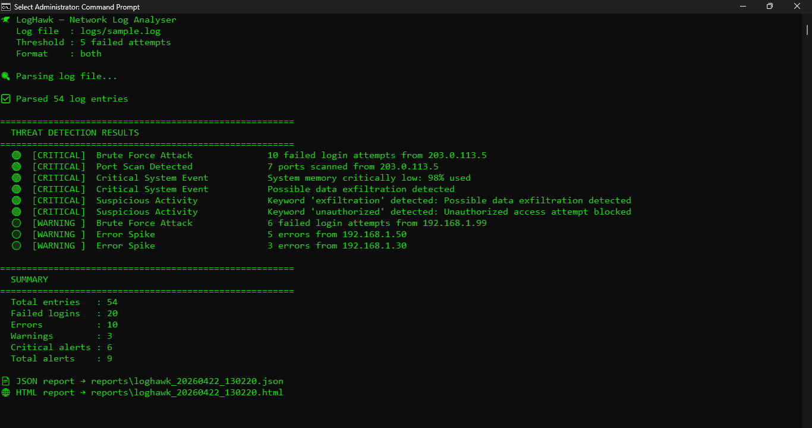

# 🦅 LogHawk — Network Log Analyser

A Python-based CLI tool that reads network and system log files, detects suspicious patterns, and generates a detailed security report — similar to how enterprise SIEM tools work.

Built to demonstrate **security-aware QA engineering skills** relevant to Network QA / SD-WAN Test Engineering roles.

---

## 📸 Demo



---

## ⚡ Quick Start

```bash
# 1. Clone the repo
git clone https://github.com/<your-username>/loghawk
cd loghawk

# 2. No dependencies needed — pure Python!
# Just run it directly:
python loghawk.py

# 3. Analyse your own log file
python loghawk.py --log path/to/your.log

# 4. Change detection threshold
python loghawk.py --threshold 3

# 5. Choose report format
python loghawk.py --format html
```

---

## 🔍 Threat Detection Rules

| Rule | Trigger | Severity |
|---|---|---|
| Brute Force Attack | Failed logins >= threshold from same IP | CRITICAL / WARNING |
| Port Scan | 3+ port scan entries from same IP | CRITICAL |
| Error Spike | 3+ errors from same IP | WARNING |
| Critical System Event | Any CRITICAL log entry | CRITICAL |
| Suspicious Keywords | exfiltration, unauthorized, malware, intrusion, exploit | CRITICAL |

---

## 📊 Sample Output

```
🦅 LogHawk — Network Log Analyser
   Log file  : logs/sample.log
   Threshold : 5 failed attempts

✅ Parsed 52 log entries

=======================================================
  THREAT DETECTION RESULTS
=======================================================
🔴  [CRITICAL]  Brute Force Attack        10 failed login attempts from 203.0.113.5
🔴  [CRITICAL]  Port Scan Detected        7 ports scanned from 203.0.113.5
🔴  [CRITICAL]  Critical System Event     System memory critically low: 98% used
🔴  [CRITICAL]  Suspicious Activity       Keyword 'exfiltration' detected
🟡  [WARNING ]  Brute Force Attack        6 failed login attempts from 192.168.1.99
🟡  [WARNING ]  Error Spike               5 errors from 192.168.1.50

📄 JSON report → reports/loghawk_20250410_143022.json
🌐 HTML report → reports/loghawk_20250410_143022.html
```

---

## 🔧 Tech Stack

- **Python 3.10+** — zero external dependencies!
- `re` — regex-based log parsing
- `collections` — Counter for pattern detection
- HTML report with dark security dashboard

---

## 📁 Project Structure

```
loghawk/
├── loghawk.py             # Main CLI entry point
├── logs/
│   └── sample.log         # Sample log file for testing
├── core/
│   ├── parser.py          # Log file parser
│   └── detector.py        # Threat detection engine
└── reports/
    └── reporter.py        # HTML + JSON report generator
```

---

## 💡 Key Design Decisions

- **Zero dependencies** — runs on any machine with Python 3.10+, no pip install needed
- **Configurable threshold** — `--threshold` flag lets you tune sensitivity without touching code
- **5 detection rules** — brute force, port scan, error spike, critical events, suspicious keywords
- **SIEM-inspired** — mirrors how enterprise Security Information and Event Management tools work

---

## 📌 Relevance to Network QA / SD-WAN Testing

| Skill Area | How this project demonstrates it |
|---|---|
| Security principles | Brute force, port scan, and anomaly detection |
| Python scripting | Full tool in pure Python with regex parsing |
| Log analysis | Structured parsing and pattern matching |
| Debugging mindset | Per-entry detail with severity classification |
| Reporting | HTML security dashboard + JSON output |
